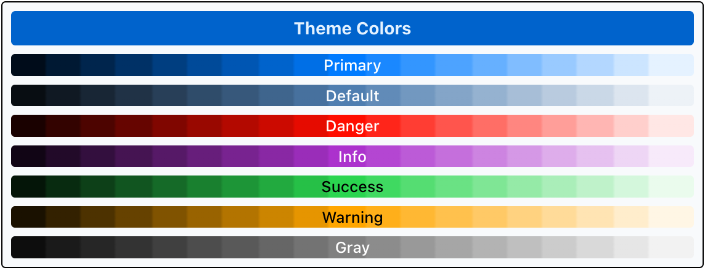
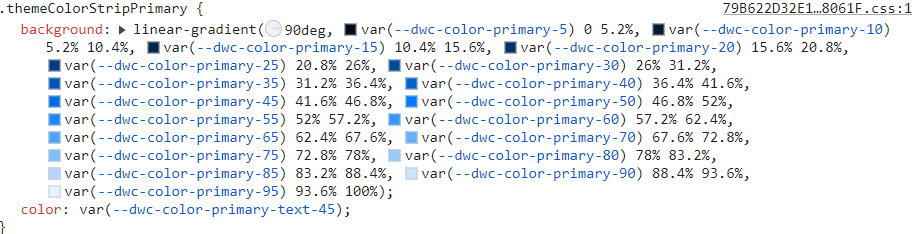
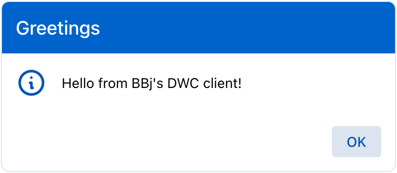
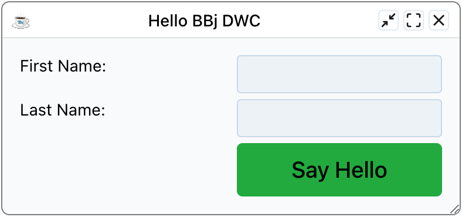
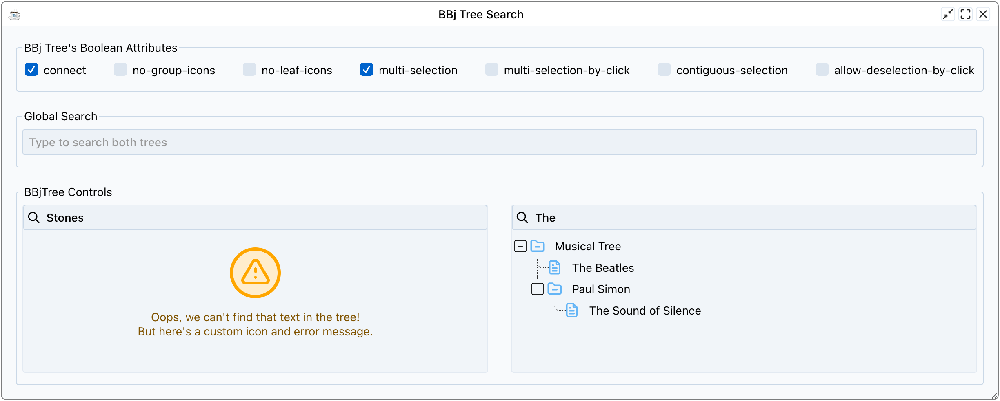
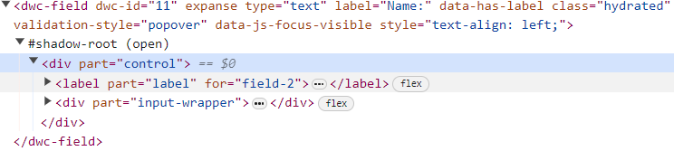
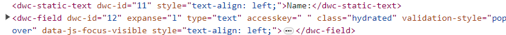
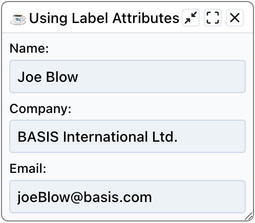
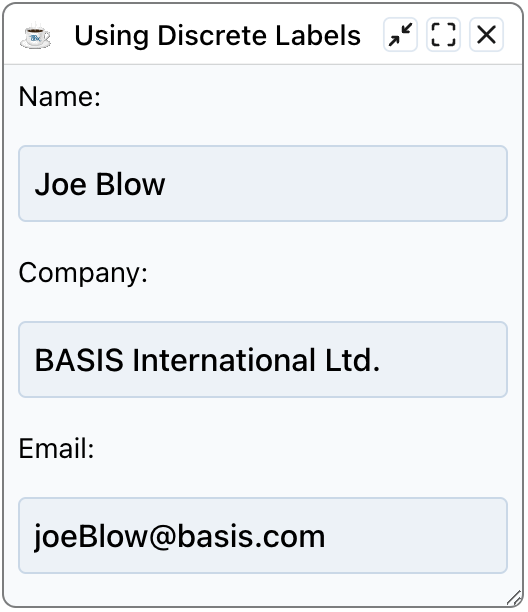

This chapter covers BBj controls implemented as web components for the Dynamic Web Client and their extended attributes.

## Overview

In creating DWC controls, BASIS has added new functionality and configuration parameters based on today's web standards and customer requests. Many of these features are available as attributes listed in the DWC-specific documentation.

## Concepts Covered in This Chapter

- Component themes for controls
- Attributes
- The BBjTree's built-in search
- Input control labels

## Component Themes

Many controls offer a "theme" attribute that can be set to one of the DWC's component themes:

| Theme | Purpose | Default Color |
|-------|---------|---------------|
| `primary` | Main color, typically brand-based | Blue |
| `default` | Gray variations tinted with primary color | Light gray with blue tint |
| `info` | Information to end-user, complementary to primary | Purple |
| `success` | Denoting successful operations | Green |
| `warning` | Presenting warnings | Yellow |
| `danger` | Presenting problems | Red |
| `gray` | Desaturated grays | Gray |

### Color Properties

In BBj 26.03, theme palettes use a seed color and hue and saturation properties:

- **Seed color** - A CSS color used to derive a palette. Example: `--dwc-color-primary-seed: #0066cc;`
- **Hue** - Degree on color wheel (0-360). Example: `--dwc-color-primary-h: 211;` (blue)
- **Saturation** - Percentage (0-100%). Example: `--dwc-color-primary-s: 100%;` (bright)

The numbered palette includes `--dwc-color-primary-25` and `--dwc-color-primary-85`. These shades provide darker and lighter colors. Use the theme's text colors for contrast instead of assuming that a shade number is a fixed lightness percentage.

{/* TODO: screenshot outdated? */}

The screenshots show an older DWC Themer. Its contrast-threshold settings no longer apply to BBj 26.03. Override the current palette properties and let the built-in theme derive its shades and contrasting text colors. Check your result in both light and dark mode.

### Setting the Theme Attribute

Most controls offer the `theme` attribute as an easy way to set the control's appearance. Two samples from the first chapter use it.

In `MessageBox.bbj`, the message box's theme is set to `primary`:

{/* TODO: screenshot outdated? */}

In `DWC1.bbj`, the [Say Hello] button's theme is set to `success`:

{/* TODO: screenshot outdated? */}

## Attributes

DWC controls offer attributes providing extra functionality beyond GUI and BUI clients.

### Common Attributes

- **theme** - Sets the control's color theme
- **expanse** - Shortcut for affecting font size and padding (controls overall size)

### BBjTree Search Attributes

| Attribute | Description |
|-----------|-------------|
| `search-input` | Shows edit box above tree for client-side filtering |
| `search-case-sensitive` | Makes search case-sensitive |
| `search-nodata` | Custom message when no search results |
| `search-placeholder` | Placeholder text for search box |
| `search-term` | Filter tree contents programmatically (supports regex) |

## Example 1 - Setting Attributes on BBjTree

1. Run `DWCTraining/04_ExtendedAttributes/TreeSearch.bbj`
2. Toggle checkboxes to enable/disable named attributes
3. Search in individual trees and via global search
4. Note custom error messages via `search-nodata` attribute
5. As time permits, read the source code and look at all the attributes it sets, including `search-input`, `search-placeholder`, `search-nodata`, `icon-collapsed` and `icon-expanded`. The code also injects custom CSS that sets the `--dwc-tree-icon-fill` custom property to a different value for each tree. The first tree paints its icons orange and the second paints them blue.

{/* TODO: screenshot outdated? */}

## Input Control Labels

BBj input controls offer a "label" attribute that creates and places a label automatically.

### Benefits of Attribute Labels

1. **Reduced developer work** - No need to create, size, and place separate text controls
2. **Validation integration** - Labels change color to denote valid/invalid states
3. **Accessibility** - Narrators recognize the label as associated with the control
4. **Responsive layouts** - Easier to design since labels are part of the control

**With attribute label:**

**Without attribute label (separate BBjStaticText):**

## Example 2 - Comparing Label Types

1. Run `DWCTraining/04_ExtendedAttributes/LabelAttributes.bbj`
2. Choose "yes" for attribute labels, then run again and choose "no"
3. Resize the window - notice how attribute labels stay with their inputs

### Why Attribute Labels Work Better

**With attribute labels:** Labels are part of the control in the DOM, staying attached during resize.

**With BBjStaticText:** Labels are separate elements that can separate from inputs when resizing.

{/* TODO: screenshot outdated? */}

{/* TODO: screenshot outdated? */}

