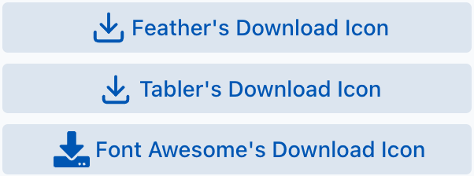
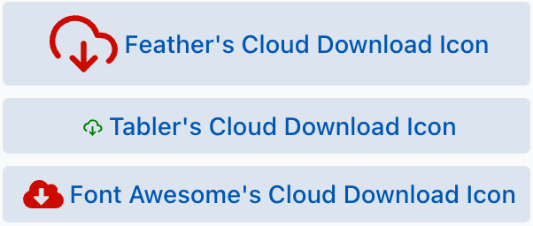
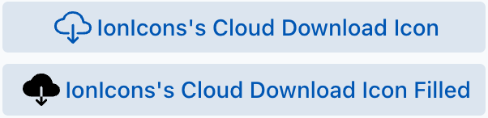
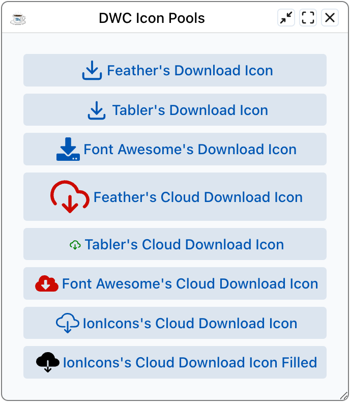

This chapter covers working with icon pools in DWC applications.

## Overview

The DWC provides built-in icon pools that allow you to easily add icons to your BBj controls without needing to manage image files.

## Using Icons in DWC

In DWC with BBj 24.11 or later, create an icon as a web component and place it in a button's `prefix` slot:

```bbj
declare auto BBjWebComponent icon!
icon! = window!.addWebComponent("dwc-icon")
icon!.setAttribute("name","sun")
button!.setText("Light Mode")
button!.setSlot("prefix",icon!)
```

This is the approach used in `DWC2.bbj`. See [`BBjControl::setSlot`](https://documentation.basis.cloud/BASISHelp/WebHelp/bbjobjects/SysGui/bbjcontrol/BBjControl_setSlot.htm) for the slot API. Controls that support HTML content can also include an icon in their text, as the examples later in this section demonstrate:

```bbj
button!.setText("<html><dwc-icon name='sun'></dwc-icon> Light Mode")
```

{/* TODO: screenshot outdated? */}


## Scalable Vector Graphics

The SVG format is an XML-based markup language that describes two-dimensional vector graphics. An SVG file describes how to draw the icon, not what the finished picture looks like. It holds instructions that tell the browser how to create the icon, so the result renders at any size without losing quality or turning blurry. You can therefore add icons to BBj controls at any size. You can size them with CSS custom properties or base the size on a known value, such as the size of the control's text. You can also define fill colors so the icon colors are variable, and you can animate the elements and attributes that make up the SVG. This flexibility makes SVG a good format for icons in controls. For more background, see the [MDN reference for SVG](https://developer.mozilla.org/en-US/docs/Web/SVG).

## Available Icon Pools

You can add the SVG source for an icon to a control's title, but it is much easier to use a pre-existing library. A library usually offers hundreds or thousands of icons that share one design language, so icons from the same library match each other and give the application a consistent look.

The DWC includes several icon pools:

- **Tabler Icons** - A comprehensive set of over 1900 icons
- [**Feather**](https://feathericons.com/) - A free, open-source set of simple icons
- [**Font Awesome**](https://fontawesome.com/icons) - The free icons of Font Awesome. The full Pro set is not free to use.
- `dwc` - The built-in icons used by DWC controls

Tabler and Feather are free-to-use, open-source libraries that keep adding new icons. Tabler and Feather icons use their plain names, such as `speakerphone` and `speaker`. Font Awesome names carry a prefix for the style: `fas-` for solid, and the other styles for regular, light, thin, duotone and brands (company logos). For example, `fas-microphone-alt` is the solid microphone icon.

Set an icon's `pool` and `name` attributes to select it, whether you create it with `addWebComponent` or include it in HTML content. `DWC2.bbj` from the first section puts a Tabler icon in its button's prefix slot and shows the Feather and Font Awesome alternatives as comments.

## Icon Syntax

### Basic Usage

```html
<dwc-icon name='icon-name'></dwc-icon>
```

### With Pool Specification

```html
<dwc-icon pool='tabler' name='icon-name'></dwc-icon>
```

## Common Icons

| Icon Name | Description |
|-----------|-------------|
| `sun` | Light mode indicator |
| `moon` | Dark mode indicator |
| `search` | Search functionality |
| `check` | Confirmation/success |
| `x` | Close/cancel |
| `plus` | Add item |
| `minus` | Remove item |
| `arrow-left` | Navigation |
| `arrow-right` | Navigation |

{/* TODO: screenshot outdated? */}


{/* TODO: screenshot outdated? */}


## Styling Icons

Icons can be styled using CSS:

```css
dwc-icon {
    color: var(--dwc-color-primary);
    --dwc-icon-size: 24px;
}
```

## Example - Adding Icons to Buttons

```bbj
declare auto BBjWebComponent btnIcon!
btn! = wnd!.addButton("Save")
btnIcon! = wnd!.addWebComponent("dwc-icon")
btnIcon!.setAttribute("name", "check")
btn!.setSlot("prefix", btnIcon!)

deleteBtn! = wnd!.addButton("Delete")
deleteBtn!.setAttribute("theme", "danger")
btnIcon! = wnd!.addWebComponent("dwc-icon")
btnIcon!.setAttribute("name", "trash")
deleteBtn!.setSlot("prefix", btnIcon!)
```

{/* TODO: screenshot outdated? */}


{/* TODO: screenshot outdated? */}


{/* TODO: screenshot outdated? */}


{/* TODO: screenshot outdated? */}


### Looking up an icon in each pool

To add a download icon to a button, first find a suitable icon. Searching the Feather, Tabler and Font Awesome libraries each turns up an icon named `download`, although the icons differ in appearance. Set the component's pool and name, then place it in the button's prefix slot. These fragments assume the window is named `window!` and continue from the declared `btnIcon!` above:

```bbj
btnFeather! = window!.addButton("Feather's Download Icon")
btnIcon! = window!.addWebComponent("dwc-icon")
btnIcon!.setAttribute("pool", "feather")
btnIcon!.setAttribute("name", "download")
btnFeather!.setSlot("prefix", btnIcon!)

btnTabler! = window!.addButton("Tabler's Download Icon")
btnIcon! = window!.addWebComponent("dwc-icon")
btnIcon!.setAttribute("pool", "tabler")
btnIcon!.setAttribute("name", "download")
btnTabler!.setSlot("prefix", btnIcon!)

btnFontAwesome! = window!.addButton("Font Awesome's Download Icon")
btnIcon! = window!.addWebComponent("dwc-icon")
btnIcon!.setAttribute("pool", "fa")
btnIcon!.setAttribute("name", "fas-download")
btnFontAwesome!.setSlot("prefix", btnIcon!)
```

### Size and color

Set `theme` or `color` on the icon component. Set `--dwc-icon-size` for its size inside the button; changing the host's width alone doesn't set the icon size. The styled buttons in `DownloadButton.bbj` use the same slot API:

```bbj
btnFeather! = window!.addButton("Feather's Cloud Download Icon")
btnIcon! = window!.addWebComponent("dwc-icon")
btnIcon!.setAttribute("pool", "feather")
btnIcon!.setAttribute("name", "download-cloud")
btnIcon!.setAttribute("theme", "danger")
btnIcon!.setStyle("--dwc-icon-size", "var(--dwc-font-size-2xl)")
btnFeather!.setSlot("prefix", btnIcon!)

btnTabler! = window!.addButton("Tabler's Cloud Download Icon")
btnIcon! = window!.addWebComponent("dwc-icon")
btnIcon!.setAttribute("pool", "tabler")
btnIcon!.setAttribute("name", "cloud-download")
btnIcon!.setStyle("--dwc-icon-size", "0.5em")
btnIcon!.setStyle("color", "green")
btnTabler!.setSlot("prefix", btnIcon!)

btnFontAwesome! = window!.addButton("Font Awesome's Cloud Download Icon")
btnIcon! = window!.addWebComponent("dwc-icon")
btnIcon!.setAttribute("pool", "fa")
btnIcon!.setAttribute("name", "fas-cloud-download-alt")
btnIcon!.setStyle("--dwc-icon-size", "1em")
btnIcon!.setStyle("color", "var(--dwc-color-danger)")
btnFontAwesome!.setSlot("prefix", btnIcon!)
```

The Feather icon uses a theme color and a font-size token. The other examples show a named color and a DWC color token. Each button keeps a plain-text title, and each icon can be changed through its BBj control object.

## Custom Icon Pools

The built-in pools are not the only choice. If you prefer your own set of icons, or they are not in SVG format, you can define a custom icon pool. It works with SVG, PNG or JPG files. When you create the pool you tell the DWC how to find the icon files, so you can load them from a CDN or from a local Jetty directory.

### Hosting the pool on a CDN

This example uses the [Ionic Ionicons library](https://ionic.io/ionicons), an open source icon library.

1. Find a CDN that hosts the library. The cdnjs service hosts Ionicons in several versions.
2. Find out how to reach the SVG files by name. On cdnjs the SVG files share the prefix `https://cdnjs.cloudflare.com/ajax/libs/ionicons/7.4.0/svg/`, followed by the icon name.
3. Use that information to build the custom pool in your BBj program:

```bbj
    rem Add a custom icon pool referencing the ionicons library from a CDN
    rem @see https://ionic.io/ionicons for the icons
        iconLibraryName$ = "ionicons"
        resolverPathCdn$ = "https://cdnjs.cloudflare.com/ajax/libs/ionicons/7.4.0/svg/${name}.svg"
        myIconPool$ = "(window.Dwc ??= {}).IconsPools ??= []; window.Dwc.IconsPools.push({ name: '" + iconLibraryName$ + "', resolver: name => `" + resolverPathCdn$ + "` });"
        web! = BBjAPI().getWebManager()
        web!.injectScript(myIconPool$)
```

The program injects JavaScript to register a pool named `ionicons`. Its resolver function maps each requested icon name to an SVG URL. The `resolverPathCdn$` variable defines that URL with a `${name}` placeholder and an `.svg` suffix.

4. Create the buttons with your custom pool name and the icons from the library:

```bbj
btnIonIcon1! = window!.addButton("Ionicons Cloud Download Icon")
btnIcon! = window!.addWebComponent("dwc-icon")
btnIcon!.setAttribute("pool", "ionicons")
btnIcon!.setAttribute("name", "cloud-download-outline")
btnIonIcon1!.setSlot("prefix", btnIcon!)

btnIonIcon2! = window!.addButton("Ionicons Cloud Download Icon Filled")
btnIcon! = window!.addWebComponent("dwc-icon")
btnIcon!.setAttribute("pool", "ionicons")
btnIcon!.setAttribute("name", "cloud-download")
btnIcon!.setStyle("fill", "currentColor")
btnIonIcon2!.setSlot("prefix", btnIcon!)
```

Running the program gives two buttons with custom icons from the CDN.

### Hosting the pool locally

If you host an icon library under `<BBjHome>/htdocs`, point `resolverPathCdn$` at its local Jetty directory. For example, place the icon files in `htdocs/icons/` and use `/files/icons/${name}.svg`. The resolver can also return a bitmap URL. Open a resolved URL in the browser to check that Jetty serves the file before using it in your pool.

## Resources

- [Tabler Icons](https://tabler.io/icons) - Browse available icons
- [BASIS Online Help](https://documentation.basis.cloud/BASISHelp/WebHelp/index.htm) - Search for "DWC icons"
