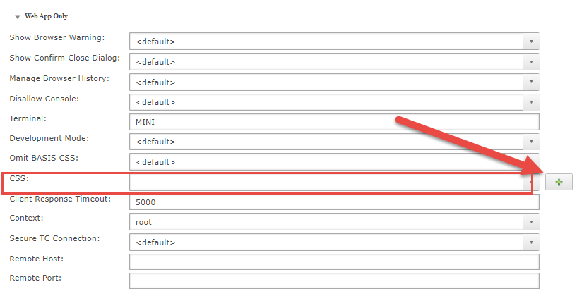

The setStyle / setPanelStyle / setDockStyle instructions directly set the style properties in the element tags of the DOM. Now we learn how to add a CSS class to a control and a window panel, and how to define the properties for such a class in an external CSS file.

Let's first create a simple CSS file `sample.css` with the following content

```css
.mypanel{
 display:inline-grid;
 grid-template-columns:1fr 1fr;
 gap:5px;
}
```

As you see we have now created a CSS class with the grid instructions we had added to the code before .

Now the three lines with the according "setStyle" instructions can be changed to the following single line:

```bbj
wnd!.addPanelStyle("mypanel")
```

In the last step we need to tell BBj to use our CSS file with this program. There are various ways to do that, but let's start with adding it in Enterprise Manager to the app directly, in the "Web App Only" section of the Application:



Add it using the "Plus" Button, save the setting and rerun the program from the link in the browser.

You should again see the program with the nice grid layout.

Now you can also add more CSS instructions to that CSS file, especially [media-queries](https://www.w3schools.com/css/css_rwd_mediaqueries.asp) if you need to do a truly responsive page that adjusts to phones and tablets and wide screens.

If you register the CSS file in Enterprise Manager, redeploy it after you change it on disk.

During development, you can instead read and [inject the stylesheet](https://documentation.basis.cloud/BASISHelp/WebHelp/bui/BBjBuiManager/BBjBuiManager_injectStyle.htm) at each start. Add this code before you create the window. Keep `sample.css` beside the program:

```bbj
use java.nio.file.Files
use java.nio.file.Paths
use java.nio.charset.StandardCharsets

declare String css!
programPath$ = BBjAPI().getProgramInfo(pgm(-2)).getCanonicalProgramName()
css! = new String(Files.readAllBytes(Paths.get(programPath$).resolveSibling("sample.css")),StandardCharsets.UTF_8)
BBjAPI().getWebManager().injectStyle(css!)
```

Reload the app after you change `sample.css` to load the updated styles.

The two files that contain the results of this lesson.

[Download `dwc-lesson-result.zip`](pathname:///files/intro-bbj/dwc-lesson-result.zip)
